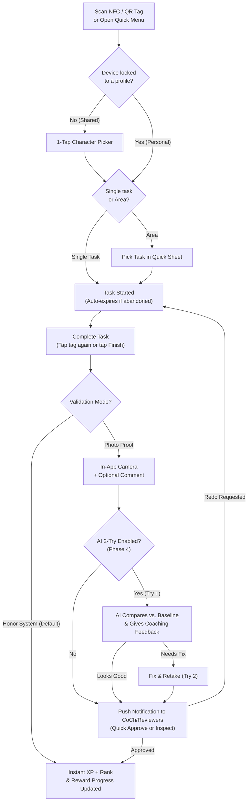

# Chore Wars — Product Spec, Gamification & Roadmap

> A lightweight, living product & technical spec for **Chore Wars** — capturing the vision, roles, gamification loop, monetization path, and phased build plan.

---

## 1. Vision & Core Concept

**Chore Wars** turns household chores into an RPG-inspired competition inside a shared **Fort** (household).

A household leader—the **Commander in Chief (CoCh)**—sets up the Fort in under a minute using a quick home wizard (house type, bedrooms, bathrooms, kitchen, yard, pets). Everyone in the Fort competes as **Characters** earning **XP (points)** by completing chores—either assigned to them or up for grabs on the Fort board.

XP powers **Goals & Rewards** (like hitting 20 XP for weekend ice cream, unlocking RPG ranks/gear, or competing for a prorated monthly Bounty Pool) so the game stays motivating whether there is a cash prize or no prize at all. Physical **NFC tags** and printable **QR stickers** placed around the house make starting and finishing a chore a 2-second tap—backed by a fast **Quick Menu** for tag-free use.

---

## 2. Roles, Characters & Devices

| Role | Who it is | Capabilities |
| :--- | :--- | :--- |
| **Commander in Chief (CoCh)** | Mom, dad, or lead roommate | Owns the Fort, runs the Home Setup Wizard, configures areas, tasks, XP values, rules, rewards/bounties, NFC/QR tags, and designates Reviewers. PIN-protected admin actions. **Also competes in the war!** |
| **Reviewer** *(Optional Role)* | Second parent, older sibling, or co-lead | Designated by the CoCh to approve/reject photo-verified chores so one person isn't a bottleneck. |
| **Recruit / Member** | Kids, partners, or roommates | Plays as a Character, claims or completes assigned/open chores, submits proof & comments when required, tracks XP, rank, and reward progress. |

### Netflix-Style Profiles & Device Binding
- **One Account, Multiple Profiles:** The CoCh logs in once and creates Character profiles for everyone in the Fort—no email or password required for kids.
- **CoCh PIN Lock:** Admin actions (editing rules, changing rewards, approving chores) require a 4-digit PIN (or Reviewer login).
- **Two Device Modes:**
  - **Locked to Profile X (Personal Device):** Bind a phone to one Character so NFC/QR taps and the home screen never ask *"Who are you?"*.
  - **Shared Device Mode (Family Phone / Tablet):** Opening the app or scanning a tag shows a fast 1-tap **"Who's playing?"** avatar row before starting the chore.

---

## 3. Core Building Blocks

### 3.1 Smart Home Setup Wizard (Zero Cold-Start Friction)
Instead of forcing the CoCh to type 20 chores from scratch on Day 1, onboarding asks a few quick taps:
- **Home Type:** House / Apartment / Studio
- **Rooms & Features:** Number of bedrooms, number of bathrooms, kitchen (yes/no), yard/outdoor (yes/no), pets (yes/no)
- **Result:** Auto-generates a ready-to-play Fort with Areas, suggested Tasks, sensible XP defaults, and honor-system validation—all editable anytime.
- **Area-less (General) Tasks:** Standalone tasks with no area (e.g., *"Take out the garbage"*, *"Bring in mail"*) are first-class citizens alongside Area tasks.

### 3.2 Tasks, Assignment & Validation
Each task supports:
- **Title & optional note**
- **Area** (optional)
- **XP Value** (inherits area default or custom override)
- **Assignment Mode:**
  - *Open ("Up for Grabs")* — anyone in the Fort can claim and earn the XP
  - *Assigned* — targeted to one or more specific Characters
- **Recurrence / Cooldown Presets:**
  - *Daily* (resets each day)
  - *Every X Days after completion* (cooldown timer starting when completed)
  - *Weekly* / *Monthly*
  - *One-Off Special Mission*
- **Anti-Squatting Timeout:** Started tasks auto-release back to the board after a configurable timeout (e.g., 60–90 minutes) if not completed.
- **Validation Mode:**
  - **Honor System *(Default & MVP)*:** Instant XP when marked complete—zero friction.
  - **Photo Proof *(Opt-in per task)*:** Completing opens the in-app camera + optional context comment (e.g., *"Didn't wipe the counter because there's a jigsaw puzzle on it"*). Sends an actionable push notification to CoCh/Reviewers (**Approve right from notification** if trusted, or tap **Inspect** to compare side-by-side against the optional CoCh baseline photo).
  - **Promote to Baseline:** Any approved submission photo can be promoted to become the task's "Gold Standard" baseline in one tap.

### 3.3 Gamification & Rewards System
Grounded in proven RPG + household gamification principles (**intrinsic progression + clear short-term goals + optional stakes**):

1. **Always-On Core Game (Zero Prize Required):**
   - **XP & Ranks:** Every completed chore earns XP toward Character ranks (*Recruit → Scout → Corporal → Captain → Legend*) and streaks—so chores never stop just because there's no cash bounty active.
   - **Fort Leaderboard:** Everyone (including CoCh!) appears on the weekly/monthly scoreboard for friendly rivalry.
2. **Individual Goal Rewards *(MVP Priority)*:**
   - CoCh sets a simple XP goal (e.g., *"Reach 20 XP this week"*).
   - Reward description is **optional**—CoCh can label it in-app (*"Ice cream on the weekend road trip"*) or keep it an IRL surprise.
   - **Eligible Participants Filter:** Rewards can include everyone or exclude specific members (e.g., Mom & Dad play for XP/leaderboard glory while the kids unlock the ice cream or allowance).
3. **Fort Bounty Pool *(Monthly Prorated Pool)*:**
   - CoCh sets a monthly pool (e.g., \$100) with **guardrails** (minimum XP threshold to qualify + optional max \$/XP cap or prorated split across the month's total task XP) so a single 5-XP chore can't sweep the entire pool.
4. **RPG Cartoon Hero & Upgrade Loop *(Generate Once, Evolve Forever)*:**
   - **Privacy-First One-Time Creation:** Players can create a stylized, sticker-like Chore Wars cartoon hero in two ways:
     1. **Snap & Shred (Optional Selfie):** Take one photo → processed in-memory via a zero-retention AI API to generate a heavily stylized cartoon mascot → **original photo is immediately discarded and never stored**.
     2. **No-Photo Hero Builder:** Pick traits/prompt (hair, glasses, favorite color, class) with zero photo required.
   - **Parent Goes First:** During onboarding, the CoCh can try generating their own Commander cartoon first to build trust before inviting kids.
   - **Cartoon-Only Upgrades:** Once the base cartoon exists, all future rank evolutions & XP-store gear (golden broom, soap shield, Fort crown) either layer on top instantaneously or use **only the saved cartoon image** as the AI input—never asking for a real photo again.
   - **Merch Tie-In:** Custom cartoon heroes can even be printed onto personalized Fort NFC/QR stickers!

---

## 4. Core Use Cases

### UC-1: 60-Second Fort Setup (CoCh)
1. CoCh signs up, names the Fort, sets a 4-digit CoCh PIN, and adds Character profiles (optionally designating other Reviewers).
2. CoCh answers the quick Home Wizard (home type, rooms, kitchen, pets) → Fort is pre-populated with Areas, Tasks, and XP values.
3. CoCh tweaks any tasks/points, sets a starter Goal Reward (optional), and starts playing immediately.

### UC-2: Tap-to-Start & Tap-to-Finish (NFC Tag or QR Sticker)
1. CoCh links a physical NFC tag (programmed in-app) or prints a Chore Wars QR sticker—both encode the exact same URL (`https://<domain>/t/<tagId>`).
2. **Tap / Scan 1 (Start):**
   - If device is **Locked to Profile X**, skips user selection; if **Shared Device**, shows 1-tap avatar picker.
   - **Single-task tag:** Immediately starts that chore (with 1-tap undo).
   - **Area tag:** Opens a focused Quick-Start sheet showing only available tasks in that area.
3. **Tap / Scan 2 (Finish):**
   - User taps again and selects **Complete**.
   - If Honor System → instant XP burst & leaderboard update!
   - If Photo Proof → opens in-app camera immediately + optional note/comment → notifies CoCh/Reviewers.

### UC-3: Quick-Menu Fallback (No Tags Required)
- Home screen shows active/assigned tasks at the top and a tappable grid of **Areas** (plus **General Tasks**) right below, running the exact same 1-tap Start → Finish flow.

### UC-4: Fast CoCh / Reviewer Approval
- Push notification arrives when a photo-verified chore is submitted.
- CoCh/Reviewer can **Quick Approve** straight from the notification if they trust it, or open the side-by-side view (**Baseline vs. Submission + Comment**) to Approve or Request Redo.

### UC-5: AI Two-Try Inspector *(Phase 4)*
- **Try 1:** Vision AI compares the submission photo (+ recruit comment) against the CoCh baseline photo and gives immediate friendly coaching so the recruit can fix missed spots privately.
- **Try 2:** Submits to CoCh/Reviewer with AI summary attached for final sign-off.

---

## 5. Task & Validation Lifecycle

---

## 6. Future Monetization & Privacy-First Data Strategy

Designed to keep the app accessible/low-cost for families while building real commercial value:

1. **Physical Tag Packs (Commerce):** Custom-illustrated Chore Wars **NFC + QR tag packs** matching the app's art style (Kitchen, Bathroom, Trash, Pets, Bonus Missions), purchasable in-app.
2. **Contextual CPG Brand Sponsorships (Household/Adult-Only):** Native, genuinely helpful recommendations shown **only to the adult CoCh** based on household-level cleaning patterns (for example, if a Fort cleans kitchen surfaces significantly more often than comparable 4-person households, show a practical tip/offer like *"Clean less often with a dust-repelling surface spray"*—ideal for CPG partners like J&J, P&G, or Clorox).
3. **Person-Agnostic Household Habit Analytics:** Designing a clean taxonomy into the database from Day 1 lets us analyze and cross-compare cleaning frequencies across cohorts (e.g., *"house of 4 with 2 kids & pets"* vs. *"2-person apartment"*) while staying **100% agnostic of which individual—especially kids—performed the chore**:
   - **Fort Cohort Attributes:** `home_type`, `bedroom_count`, `bathroom_count`, `has_kitchen`, `has_yard`, `has_pets`, `total_profiles` (aggregate counts only, zero child PII).
   - **Canonical Taxonomy Keys:** Every preset Area and Task carries a stable `category_key` (e.g., `kitchen`, `bathroom`, `counter_wipe`, `dishes`, `trash`, `floor_sweep`) even if the CoCh renames the display label, enabling clean cross-household comparisons.
   - **Event Metrics:** Frequency per area/task category, day-of-week, time-of-day, and completion duration (`completed_at - started_at`).
4. **Optional Low-Cost Fort Pass (Freemium):** Free core experience; small subscription unlocks AI 2-try photo inspections, unlimited custom rewards, and extra RPG character gear.
5. **Kid Privacy Guardrail (Important!):** Never attach ad targeting, behavioral profiling, or analytics attribution to child profiles—keep all sponsorships, purchases, and habit insights strictly at the **adult CoCh / person-agnostic household** level to stay compliant with COPPA, GDPR-K, and App Store / Google Play family policies.

---

## 7. Phased Roadmap

| Phase | Focus | Key Deliverables |
| :--- | :--- | :--- |
| **Phase 0** *(Done)* | Foundation & Live Deploy | Expo SDK 58 + Expo Router + TypeScript, preserved logo & `#000033` / `#FF5A00` theme, `/api/health` verified live on Vercel (`chorewars-two.vercel.app`). |
| **Phase 1** *(Next)* | Auth, Home Wizard, Profiles & Core Board | Neon Postgres + Drizzle ORM, CoCh auth (JWT/session), Fort Home Wizard (auto-generates areas/tasks), Netflix-style Character profiles + CoCh PIN + Device Lock, Honor-system chore completion, Goal Rewards (with participant exclusion), and live Fort Leaderboard. |
| **Phase 2** | Photo Proof, Reviewers & Bounty Pool | `expo-camera` proof + optional comments, cloud photo storage (Vercel Blob / R2), delegated Reviewers, actionable review queue (side-by-side Baseline vs. Submission + "Promote to Baseline"), QR sticker generator (`/t/<tagId>`), and Monthly Prorated Bounty Pool. |
| **Phase 3** | NFC Tags & Push Notifications | Expo Development Build (`eas build --profile development`), in-app NFC tag writing/reading sharing `/t/<tagId>`, push notifications (`expo-notifications`) with quick-approve actions, and task auto-expire reminders. |
| **Phase 4** | AI Inspector, Character Builder & Revenue | 2-try Vision AI baseline comparison, RPG Character cosmetics/store, custom-art NFC/QR tag pack ordering, contextual CoCh CPG placements, and App Store / Google Play launch. |

---

## 8. Phase 1 Technical Blueprint (Neon Postgres + Expo Router API)

### Core Tables (Drizzle Schema)
- `accounts` — CoCh login (`id`, `email`, `password_hash`, `created_at`)
- `forts` — Household (`id`, `owner_account_id`, `name`, `home_type`, `bedroom_count`, `bathroom_count`, `has_kitchen`, `has_yard`, `has_pets`, `coch_pin_hash`, `created_at`)
- `profiles` — Characters (`id`, `fort_id`, `name`, `role`: `'coch' | 'reviewer' | 'recruit'`, `is_adult`, `avatar_key`, `avatar_url` nullable, `xp_total`, `created_at`)
- `areas` — Zones (`id`, `fort_id`, `name`, `category_key`, `icon_key`, `default_xp`, `sort_order`)
- `tasks` — Chores (`id`, `fort_id`, `area_id` nullable, `title`, `category_key`, `xp`, `recurrence_type`, `cooldown_days`, `validation_mode`, `assigned_profile_id` nullable, `is_active`)
- `task_runs` — Active/completed chore instances (`id`, `task_id`, `fort_id`, `profile_id`, `status`: `'in_progress' | 'pending_review' | 'approved' | 'rejected' | 'expired'`, `started_at`, `completed_at`, `duration_seconds`, `expires_at`, `xp_awarded`, `comment`, `proof_photo_url`)
- `rewards` — Goals & Bounties (`id`, `fort_id`, `title` nullable, `type`: `'individual_goal' | 'bounty_pool'`, `target_xp`, `pool_amount_cents` nullable, `excluded_profile_ids`, `is_active`)

### First Phase 1 API Endpoints (`src/app/api/*+api.ts`)
- `POST /api/auth/register` & `POST /api/auth/login` & `GET /api/auth/me`
- `POST /api/forts/setup` (Home Wizard → creates Fort, initial Profiles, Areas & Tasks in one transaction)
- `GET /api/forts/current` (loads Fort, Profiles, Areas, Tasks, Active Runs, Rewards, Leaderboard)
- `POST /api/tasks` / `PATCH /api/tasks/[id]`
- `POST /api/tasks/[id]/start` & `POST /api/tasks/[id]/complete`
- `POST /api/rewards` & `GET /api/leaderboard`

### First Phase 1 Screens (`src/screens/`)
1. **Login / Register** (wire up existing `LoginScreen`)
2. **Fort Home Wizard** (if no Fort yet: Name Fort → Home Type/Rooms → Create Profiles & CoCh PIN → Review Starter Chores)
3. **Profile Switcher ("Who's Playing?")** (with "Lock this device to me" toggle)
4. **Main Tabs:**
   - **Battle Board (Home Quick Menu):** In-progress chores, Assigned to me, Areas grid + General tasks
   - **Scoreboard & Rewards:** Live XP leaderboard, Character rank, Goal Reward progress bars
   - **Fort Command (CoCh PIN-protected):** Manage Areas, Tasks, Profiles, Rewards, and Device Lock
